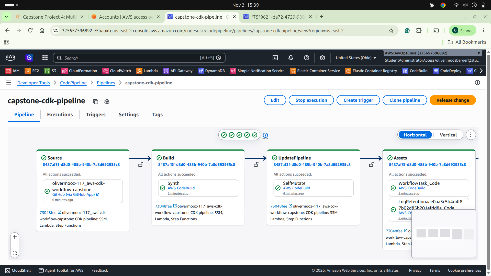
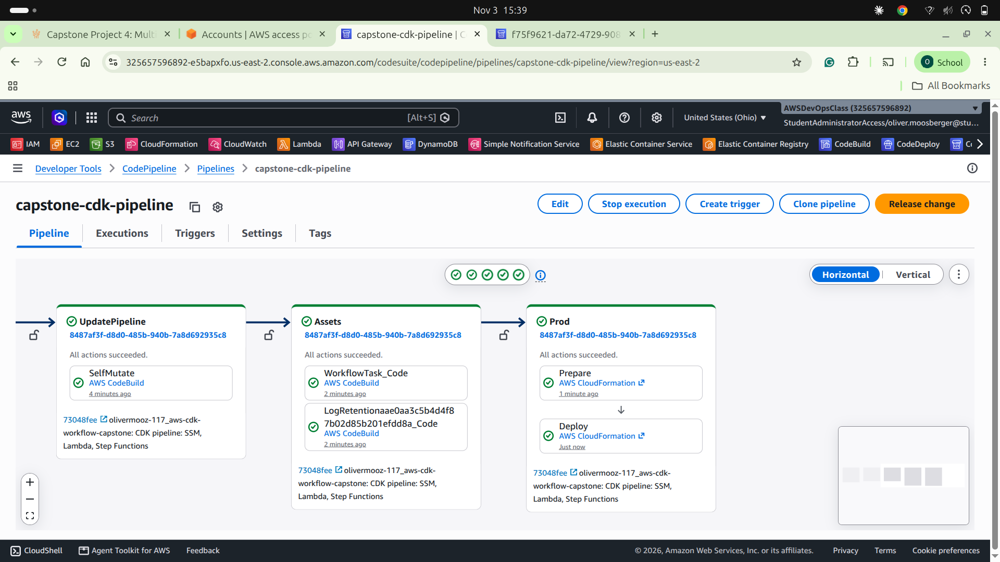
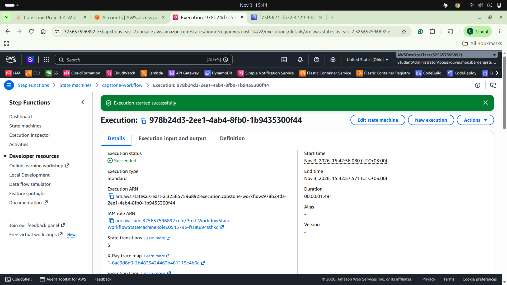
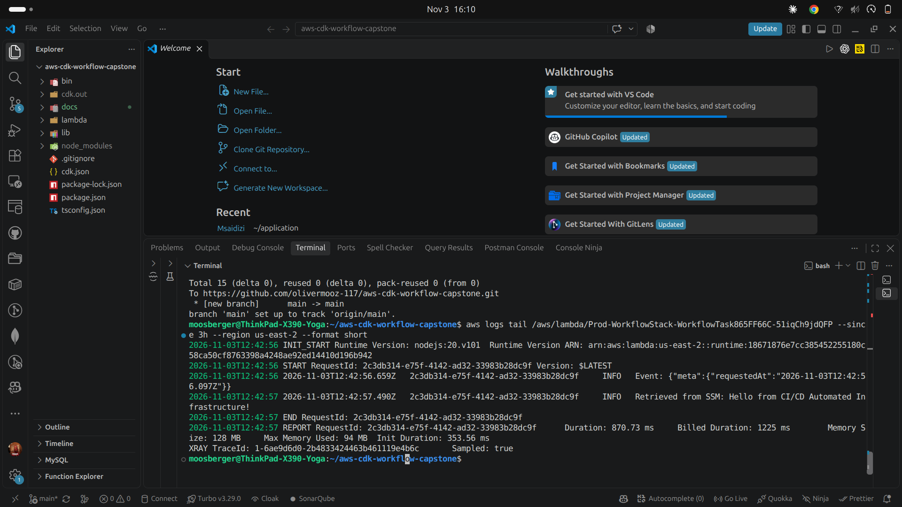
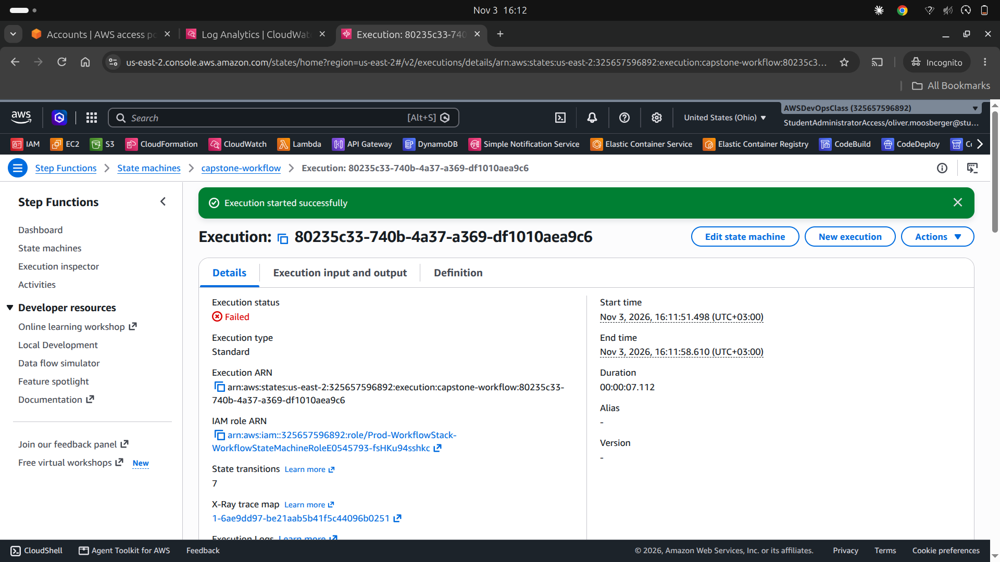

# AWS CDK Serverless Workflow with an Automated CI/CD Pipeline

An AWS CDK (TypeScript) application that deploys a serverless workflow, **AWS Step Functions orchestrating a Lambda function that reads its configuration from SSM Parameter Store**, through a fully automated **CDK Pipeline** (CodePipeline and CodeBuild). Every push to `main` rebuilds and redeploys the infrastructure.

**Repository:** [olivermooz-117/aws-cdk-workflow-capstone](https://github.com/olivermooz-117/aws-cdk-workflow-capstone)
**Region:** US East (Ohio), `us-east-2`
**Author:** Oliver Moosberger

## Table of Contents

- [AWS CDK Serverless Workflow with an Automated CI/CD Pipeline](#aws-cdk-serverless-workflow-with-an-automated-cicd-pipeline)
  - [Table of Contents](#table-of-contents)
  - [Architecture](#architecture)
  - [Repository Structure](#repository-structure)
  - [Infrastructure as Code and Configuration](#infrastructure-as-code-and-configuration)
  - [Step Functions Workflow](#step-functions-workflow)
  - [CI/CD Pipeline](#cicd-pipeline)
  - [Evidence](#evidence)
    - [Pipeline execution](#pipeline-execution)
    - [Step Functions execution](#step-functions-execution)
    - [Lambda reading the value from SSM Parameter Store](#lambda-reading-the-value-from-ssm-parameter-store)
    - [Error handling: retries and catch](#error-handling-retries-and-catch)
  - [Setup and Deployment](#setup-and-deployment)
  - [Challenges and Fixes](#challenges-and-fixes)
  - [Cleanup](#cleanup)

## Architecture

```text
GitHub (push to main)
   |
   v
CodePipeline: capstone-cdk-pipeline  (CDK Pipelines)
   |-- Source          GitHub via CodeConnections (us-east-2)
   |-- Build           CodeBuild: npm ci, npm run build, cdk synth
   |-- UpdatePipeline  pipeline updates itself (self-mutation)
   |-- Assets          publishes the Lambda code asset
   '-- Prod            CloudFormation deploys WorkflowStack
                          |
                          v
        Step Functions state machine: capstone-workflow
          Prepare Input (Pass) --> Invoke Task (Lambda, retry + catch)
                                       |-- success --> Workflow Succeeded
                                       '-- failure --> Workflow Failed
                                       |
                                       v
                         Lambda (Node.js 20) --reads--> SSM Parameter
                                                        /app/config/greeting
```

| Component | Detail |
|---|---|
| IaC | AWS CDK v2, TypeScript |
| Pipeline | `capstone-cdk-pipeline` (CDK Pipelines) |
| Stacks | `WorkflowPipelineStack` (pipeline), `Prod-WorkflowStack` (application) |
| Configuration | SSM String parameter `/app/config/greeting` |
| Compute | Lambda `WorkflowTask`, Node.js 20, AWS SDK v3 |
| Orchestration | Step Functions state machine `capstone-workflow` |
| Logging | Lambda and state machine logs in CloudWatch Logs, X-Ray tracing enabled |

## Repository Structure

```text
aws-cdk-workflow-capstone/
├── bin/app.ts                 # CDK app entry point (pipeline stack, us-east-2)
├── lib/
│   ├── pipeline-stack.ts      # CDK Pipeline: GitHub source, synth, deploy stage
│   ├── app-stage.ts           # Deployable stage that wraps the workflow stack
│   └── workflow-stack.ts      # SSM parameter, Lambda, IAM grant, state machine
├── lambda/index.js            # Lambda source: reads the SSM parameter
├── docs/                      # Evidence screenshots
├── cdk.json                   # CDK app command and context values
├── package.json, tsconfig.json
└── README.md
```

## Infrastructure as Code and Configuration

All resources are declared in CDK; nothing is created by hand except the one-time GitHub connection.

- **SSM Parameter:** `ssm.StringParameter` creates `/app/config/greeting` with the value `Hello from CI/CD Automated Infrastructure!`.
- **Lambda:** `lambda/index.js` reads the parameter at runtime with `@aws-sdk/client-ssm` (`GetParameterCommand`) and logs it. The parameter name is passed in through the `PARAM_NAME` environment variable instead of being hardcoded in the function.
- **Least-privilege IAM:** `configParam.grantRead(taskFn)` gives the Lambda read access to this one parameter only. No wildcard resources.
- **Logging:** the Lambda log group keeps logs for one week.

```javascript
const result = await ssm.send(new GetParameterCommand({
  Name: process.env.PARAM_NAME || '/app/config/greeting',
  WithDecryption: false,
}));
console.log('Retrieved from SSM:', result.Parameter.Value);
```

## Step Functions Workflow

The state machine `capstone-workflow` is defined in CDK (`lib/workflow-stack.ts`):

1. **Prepare Input** (`Pass`): keeps the original input and adds a `requestedAt` timestamp under `$.meta`.
2. **Invoke Task** (`Task`, Lambda): invokes the function from the previous section.
   - **Retry:** up to 2 attempts with exponential backoff (2 s, then 4 s) on `States.TaskFailed` and Lambda service errors.
   - **Catch:** any other error (`States.ALL`) goes to the **Workflow Failed** state, with the error details stored in `$.error`.
3. **Workflow Succeeded** (`Succeed`) or **Workflow Failed** (`Fail`).

**Testing the error path:** the Lambda throws on purpose when the input contains `{"simulateError": true}`. Starting an execution with that input shows the retries and the catch path.

## CI/CD Pipeline

The pipeline is a CDK Pipeline defined in `lib/pipeline-stack.ts`.

| Stage | What it does |
|---|---|
| Source | Pulls `main` from GitHub through an AWS CodeConnections connection created in `us-east-2`. A push to `main` starts the pipeline. |
| Build | CodeBuild runs `npm ci`, `npm run build` and `npx cdk synth`. |
| UpdatePipeline | The pipeline reconfigures itself if the pipeline definition changed. |
| Assets | Publishes the Lambda code asset. |
| Prod | CloudFormation creates or updates `Prod-WorkflowStack`. |

## Evidence

### Pipeline execution

All stages succeeded: Source, Build, UpdatePipeline, Assets and Prod.





### Step Functions execution

A manually started execution with input `{}`: Prepare Input, Invoke Task and Workflow Succeeded all completed.



### Lambda reading the value from SSM Parameter Store

CloudWatch Logs for the Lambda function, retrieved with `aws logs tail`:



```text
INFO  Event: {"meta":{"requestedAt":"2026-11-03T12:42:56.097Z"}}
INFO  Retrieved from SSM: Hello from CI/CD Automated Infrastructure!
REPORT Duration: 870.73 ms  Billed Duration: 1225 ms  Memory Size: 128 MB  Max Memory Used: 94 MB
```

### Error handling: retries and catch

An execution with input `{"simulateError": true}`. The Lambda fails, Step Functions retries it, and the catch path ends in the **Workflow Failed** state.



## Setup and Deployment

Prerequisites: AWS CLI v2 with credentials for the target account, Node.js 20 or later, a GitHub repository for this code.

1. **Create a GitHub connection in the target region.** In the console go to Developer Tools, then Settings, then Connections, with the region set to `us-east-2`. Create a GitHub connection and wait for the status to become Available. Connections are regional, so one from another region will not work.
2. **Set the connection ARN.** Put it in `cdk.json` under `context.connectionArn`, and set `githubRepo` to your `owner/repo`.
3. **Install dependencies:**
   ```bash
   npm ci
   ```
4. **Bootstrap CDK once per account and region:**
   ```bash
   npx cdk bootstrap aws://ACCOUNT_ID/us-east-2
   ```
5. **Deploy the pipeline once:**
   ```bash
   npx cdk deploy --require-approval never
   ```
6. **Push to `main`.** From now on every push triggers the pipeline, which deploys `Prod-WorkflowStack`.
7. **Run the workflow:** in Step Functions, open `capstone-workflow`, click Start execution, and use `{}` as the input.

Troubleshooting notes from this build are listed below.

## Challenges and Fixes

- **AWS SDK v2 is not available in current Lambda runtimes.** The skeleton in the brief uses `aws-sdk` v2. Node.js 18+ runtimes only include SDK v3, so the function uses `@aws-sdk/client-ssm` on Node.js 20.
- **GitHub connections are regional.** A connection created in another region cannot be used by a pipeline in `us-east-2`, so a new connection was created in Ohio and its ARN used in `cdk.json`.
- **`cdk bootstrap` reported `NoCredentials`** with an SSO login. Fixed by exporting temporary credentials with `eval "$(aws configure export-credentials --format env)"`.
- **`cdk bootstrap` timed out (`ETIMEDOUT`).** Node was trying IPv6 first. Fixed with `NODE_OPTIONS="--dns-result-order=ipv4first --no-network-family-autoselection"`.
- **Pass state must not require optional input.** A `$.simulateError` path in the Pass state would fail for the plain `{}` input. The Pass state now adds metadata under `$.meta` and keeps the original input unchanged.
- **CloudWatch console log table did not render text in the browser used.** The same log lines were captured from the terminal with `aws logs tail`.

## Cleanup

To avoid charges after grading:

1. Delete the application stack: `Prod-WorkflowStack` in CloudFormation.
2. Delete the pipeline: `npx cdk destroy WorkflowPipelineStack`.
3. Empty and delete the pipeline artifact S3 bucket if it is left behind.
4. Delete the GitHub connection and any GitHub personal access tokens.
5. Optionally delete the `CDKToolkit` bootstrap stack and its bucket.